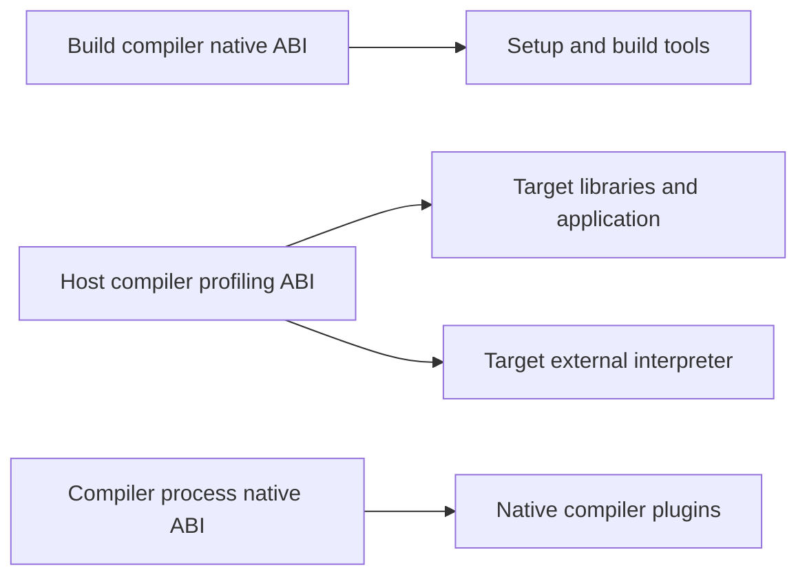

# ABI qualified compiler targets

## Purpose and decision

Profiling becomes a separate Haskell target ABI selected by a compiler such as
`aarch64-darwin-prof-ghc`. Its libraries use ordinary `Foo.hi`, `Foo.o`, and
`libHSfoo.a` names. The complete target name identifies the package universe;
profiling does not add another library way to an ordinary compiler.

Use one canonical logical target name throughout GHC and Cabal. Preserve the
underlying machine triple, including its C ABI environment, separately for
platform decisions and external toolchains. Reuse Cabal's existing Build and
Host stages. Keep profiling instrumentation and interpreter policy in a small
adapter around that general target identity.

This specification defines the next revision of [GHC #199](https://github.com/stable-haskell/ghc/pull/199)
and [Cabal #501](https://github.com/stable-haskell/cabal/pull/501). The source
baseline is GHC `c2faa54b77b2a0bf228e7e11bc9d80334be308a2` and Cabal
`99b826a276e845bbe3e623e5c5bddc22731605fa`. These are design requirements,
not a claim that the qualified-name protocol is already implemented. Execution
order and file responsibilities are in the [implementation plan](profiling-qualified-target-plan.md).

## Problem and intended users

A developer should select a profiling compiler in the same way they select a
cross compiler. Cabal should compile Setup programs and build tools with the
Build compiler, and libraries and applications with the Host compiler. This
must work when both compilers produce code for the same CPU and OS but use
incompatible Haskell closure layouts.

Toolchain distributors need native and profiling targets in one relocatable
installation without overlapping databases or ambiguous executable selection.
Package builders need distinct identities for such targets as
`arm-unknown-linux-gnueabi`, `arm-unknown-linux-gnueabihf`, and either target
with profiling enabled. A package author should not have to invent a new
`os(...)` condition or maintain parallel profiling object names.

The current branch already separates profiling code generation from ordinary
build ways, but assembles target identity independently in several places.
Cabal's `Platform` contains architecture and OS; it is not a lossless target
identifier. Its existing `AbiTag` also carries compiler-build identity and
must retain that job. Neither type alone is the complete package identity.

There is an earlier loss boundary in GHC: `ghc-toolchain`'s `parseTriple`
discards a fourth environment component, and `targetPlatformTriple` rebuilds a
string from architecture, OS, and vendor. Preserving the C ABI requires fixing
that producer as well as retaining the string in Cabal. This is a source-level
finding, not evidence of a reproduced ARM runtime failure.

## Scope and success criteria

The result must satisfy requirements R1 through R12.

| ID | Requirement |
| --- | --- |
| R1 | One canonical target name survives GHC configuration, installation, compiler discovery, Cabal planning, hashing, stores, and plan output. |
| R2 | C ABI information such as `gnueabi` versus `gnueabihf` survives independently of the profiling qualifier. |
| R3 | Profiling target artifacts use ordinary filenames. Automatic `_p`, `.p_hi`, `.p_o`, and combined profiling-way filenames disappear from GHC, Cabal, and build drivers. |
| R4 | Native and profiling targets cannot consume each other's packages or interfaces through default discovery. Explicit incompatible interface use fails before code is loaded. |
| R5 | Existing Build/Host routing handles the same-machine, different-Haskell-ABI case. Target identity equality is distinct from whether an executable can run on the build machine. |
| R6 | C, C++, CPP, hsc2hs, assembler, linker, LLVM, and configure probes receive the machine target and matching flags, never the logical `-prof` qualifier. |
| R7 | Profiling instrumentation, RTS choice, external interpretation, Template Haskell, and native compiler plugins remain correct. |
| R8 | Ordinary compilers reject legacy profiling-way requests with an actionable migration error; a profiling compiler accepts redundant profiling enablement without creating a second artifact way. |
| R9 | Older compiler metadata has a documented fallback. Contradictory or unsafe new metadata fails early rather than silently selecting a native target. |
| R10 | Compiler build ABI tags, explicit stage/package configuration, and existing nonprofiling cross targets retain their meaning. |
| R11 | Fresh installation and relocated installation pass end-to-end regressions, including both positive execution and incompatible-target negatives. |
| R12 | Profiling-specific code is limited to profiling semantics; generic target identity and independent bug fixes have separately reviewable changes. |

The initial runnable product is a native executable GHC targeting its own
machine's profiling ABI, with static nonthreaded and threaded RTS support.
The identity model also covers different-machine profiling targets. Shipping
such a toolchain still requires its normal backend, sysroot, libraries, and
execution mechanism; the names do not supply them.

New ARMv6 code generation, profiling shared libraries, profiling debug RTS,
JavaScript/Wasm profiling, and a complete Hadrian implementation of the new
target are outside this revision. Existing dynamic artifact conventions such
as `.dyn_hi` are outside the profiling-way deletion. User-selected output
filenames are not banned just because they happen to contain `_p`.

## Target identity contract

### Three distinct identities

Let `M` be the configured canonical machine target, `A` the Haskell target ABI,
and `T` the canonical logical target name.

```text
T = M                 when A is the default ABI
T = M + "-prof"       when A is the profiling ABI

Examples
M = aarch64-apple-darwin           T = aarch64-apple-darwin-prof
M = aarch64-unknown-linux          T = aarch64-unknown-linux-prof
M = arm-unknown-linux-gnueabihf     T = arm-unknown-linux-gnueabihf-prof
```

The compiler's flavour, version, and compiler-build ABI remain separate from
`T`. Two compilers can target the same `T` and still produce incompatible code
because they have different compiler builds. Conversely, changing `T` must
separate packages even if the compiler executable and version are identical.

`M` comes from the configured target before conversion to `ArchOS` or Cabal
`Platform`. Preserve its environment component and the existing canonical
machine spelling used at configuration. Do not reconstruct it from a lossy
platform value or from the LLVM triple. An explicit LLVM target override may
use a different accepted spelling and must remain available independently.
Toolchain flags remain necessary for ABI details not encoded in the triple.

The qualifier is terminal and reserved by the Haskell target protocol. Split
only a recognised terminal `-prof`, at the Haskell boundary. Never split on a
fixed component count or treat `gnueabihf` as a profiling mode. Generic Cabal
identity code treats `T` as an opaque validated value; profiling semantics come
from compiler metadata, not from repeated string matching at call sites.

### Canonical names and short aliases

The compiler reports exactly one canonical `T`. An installation may expose
`aarch64-darwin-prof-ghc` as an alias of
`aarch64-apple-darwin-prof-ghc` when that is the installation's actual `M`.
Likewise, a versioned executable alias selects that same target. Both aliases
must report identical metadata, databases, and package identities.

Generate aliases from the installation's target manifest. Resolve aliases
before target settings and library lookup. Reject an alias that would identify
more than one installed target. Cabal trusts the selected compiler's canonical
metadata and does not globally infer an omitted vendor, guess `apple`, or use
the executable basename as the target identity.

`aarch64-unknown-linux-prof` is a valid name when the configured `M` really is
`aarch64-unknown-linux`. It is not automatically an alias of every GNU, musl,
or version-qualified Linux target. Vendor spelling alone does not establish
ABI compatibility.

### Safe representation

New target-name metadata must be a nonempty ASCII identifier consisting of
letters, digits, `_`, `.`, and `-`, beginning and ending with a letter or digit.
Reject empty hyphen components, `.` or `..` components, path separators,
whitespace, control characters, and names that cannot be represented safely
as one filesystem component. Preserve spelling after producer
canonicalization; consumers must not silently lowercase, truncate, or rewrite
distinct values. Check collisions on case-insensitive installation filesystems.

Use a small validated `TargetName` abstraction at identity boundaries. Keep
`Platform = Platform Arch OS` and `CompilerId` intact. This revision does not
introduce a universal platform ABI enum or a new cross-compilation solver.

## GHC and package-tool protocol

### Metadata and queries

Add the lower-case settings key `target name`. The settings producer writes
the canonical value after selecting the target ABI. For a compiler exposing
the new protocol, `--info` includes:

| Field | Ordinary compiler | Profiling compiler |
| --- | --- | --- |
| `Target platform` | `M` | `M` |
| `Target name` | `M` | `M-prof` |
| `Target ABI` | empty string | `profiling` |
| `GHC Profiled` | `NO` | `YES` |

`profiling` remains the semantic ABI value; `prof` is its target-name
qualifier. They are an explicit mapping, not two independently configurable
switches. Keep `Target platform` machine-only so existing OS, architecture,
configure, and toolchain consumers do not receive a Haskell qualifier. Add
`--print-target-name` for the selected logical target. Existing host/build
platform queries keep their existing meaning.

Settings loading validates `T` against `M` and the selected ABI. For the
default ABI require `T == M`; for profiling require `T == M ++ "-prof"`.
Unknown ABI modes remain an explicit unsupported-target error in GHC. A
missing `target name` in an older settings file preserves the old metadata
and namespace protocol; it must not accidentally advertise the new contract
while continuing to use old discovery paths. ABI/layout selection comes from
validated settings, never just the name of a symlink.

There must be one effective value per identity field in `--info`. Audit raw
settings versus computed fields so a duplicate or override cannot make GHC,
`ghc-pkg`, and Cabal interpret different target names. Conflicting identity
settings fail before package discovery or external tool execution.

### Toolchain production and dispatch

Retain the configured complete machine triple in `GHC.Toolchain.Target` and
its serialized form. `targetPlatformTriple`, settings generation in
`ghc-toolchain` and Hadrian, and bindist generation must use that retained
value. Updating the serialized record requires updating all constructors and
fixtures together. Do not replace `tgtLlvmTarget` or alter C ABI flags.

`ghc-toolchain --triple` and existing C configure target inputs take `M`.
Passing a logical `M-prof` to such an input must produce an early diagnostic
directing the caller to the separate Haskell ABI selection. The Makefile's
stage3 target name changes from `M-profiling` to `M-prof`; its `TRIPLE` remains
`M`, and its `ABI` remains `profiling`.

Configure-script probes follow the selected Cabal stage. For a Host package,
the default configure arguments are `--host=<Host M>` and
`--build=<Build M>`; for a Build package, both default to the Build compiler's
full machine triple. These are the complete configured triples, including any
environment component. An explicit user `--host` or `--build` value takes
precedence over its inferred default. Preserve these values through both
Setup hook paths and through the serializable external-Setup configuration
used to invoke `configure`. Reject a logical `M-prof` at this C-toolchain
boundary with guidance to pass machine-only `M` and select the Haskell ABI
separately.

Autoconf compares raw `--host` and `--build` aliases before running native
probes; some Configure packages do not use `config.sub`. At this argument
boundary only, reconcile a legacy bare `-linux` tail with the otherwise
identical `-linux-gnu` spelling. When both values are inferred, use the full
GNU spelling for both. When one value is explicit, preserve that literal and
align only its inferred counterpart. Preserve all explicit arguments and
their order; the effective last explicit value controls this reconciliation.
When both values are explicit, preserve both unchanged. Perform this step
while provenance is known, before Setup serialization or inferred defaults
are merged with user arguments. This rule does not equate GNU with musl,
`gnueabi` with `gnueabihf`, or different machines or vendors. It does not
rewrite `M`, `T`, hashes, or namespaces, and is not a binary compatibility
predicate. Continue rejecting every logical `M-prof` argument before dispatch.

Installed target directories use `targets/T/lib`; the manifest and all
dispatched programs select the same directory. Cover `ghc`, `ghc-pkg`,
`runghc`, hsc2hs, and other actually shipped target helpers. Do not invent a
profiling Haddock executable when the target does not ship one. Renaming or
moving the installation must preserve target selection through the existing
relocation mechanism. A missing profiling target is an error, with no fallback
to the native library tree.

### Databases and package environments

For compilers advertising `Target name`, define the versioned namespace:

```text
N = T + "-" + compilerVersion

Example N = aarch64-apple-darwin-prof-9.14.0
```

Use `N` for the target/version subdirectory beneath the existing user data
root and for the suffix of `.ghc.environment.N`. Preserve the existing
`~/.ghc` versus XDG root preference. GHC, `ghc-pkg`, Cabal user-database
discovery, Cabal install `--lib`, and package environment writers/readers must
use this exact same rule. `--print-target-name` provides the name, not a path.

This deliberately changes new-protocol native namespaces too: the old
`arch-os-version` name cannot distinguish machine ABI environments. New
compilers must not search the old lossy namespace automatically. Explicit
database and environment-file paths remain available, subject to normal
package/interface checks. Do not merge, rename, symlink, or recache databases
from another namespace during upgrade.

The presence of `Target name` is the opt-in to this namespace protocol. Old
GHC and old experimental profiling compilers retain their exact legacy
namespace calculation when used by new Cabal. A legacy compiler cannot gain
stronger C ABI database isolation merely because Cabal inferred a better store
name. Report that compatibility limit in migration documentation.

### Compiler and package tool pairing

Add a read-only `ghc-pkg --info` query using the same machine-readable list of
string pairs as GHC `--info`. It resolves the selected target settings without
reading or creating a user database. For a new-protocol target it reports
`Project version`, `Target platform`, `Target name`, `Target ABI`, `LibDir`,
and `Global Package DB`. The query must inspect the package tool's own selected
target, including dispatch aliases and configured arguments; Cabal must not
fabricate these values by copying the compiler's properties onto the tool.
`LibDir` and `Global Package DB` describe the selected installation defaults,
independently of explicit package database stack overrides. Such overrides
must not make a mismatched tool pass the identity check.

After selecting `ghc-pkg`, Cabal compares these fields with the compiler's
metadata, including resolved installation paths for `LibDir` and the global
database. Canonical and short aliases of the same installation must pass.
Same-version native and profiling tools, tools from another installation,
missing identity fields, and contradictory settings must fail before any
package DB mutation. A new-protocol compiler paired with a tool that lacks
the query is an incompatible toolchain, not a reason to downgrade to legacy
discovery. Apply the check to both inferred and explicit `--with-hc-pkg`
selection, and independently to each Build/Host toolchain.

Retain the existing version check and discovery protocol for legacy compilers.
That compatibility path cannot promise the new handshake or full machine ABI
validation. Explicit package database paths remain separate inputs; they must
not rewrite the selected tool's reported target identity. Installation path
comparison resolves symlinks and filesystem case rules, rather than comparing
the spelling of executable paths.

## Cabal architecture and identity

### Metadata ingestion

Put lossless target lookup, validation, legacy fallback, and rendering behind
one Cabal library API. Store the validated result in compiler properties or a
small derived value; avoid adding ABI fields throughout `Platform`. Every
call site uses that API instead of appending `compilerTargetAbi` locally.

For new GHC metadata validate the same field relationships as GHC. Cabal must
reject contradictory `Target name`, `Target platform`, and `Target ABI`
values before planning or writing into a store. A new profiling name without
the profiling semantic field is contradictory. For older GHC, derive the
logical identity from its full `Target platform` and the recognised legacy
`Target ABI: profiling` value. If neither is available, preserve the existing
compiler-family `Platform` fallback. Unknown nonempty legacy ABI values must
not be silently treated as native or assigned profiling semantics.

Keep original compiler properties available for diagnostics and toolchain
configuration. Propagate the selected target identity and metadata protocol
to configured program entries; pairing Build metadata with Host programs or
vice versa is invalid. Package-tool selection must use the chosen compiler's
installation and target dispatch, including the identity handshake for explicit
`--with-hc-pkg` paths.

### Hashes and paths

The package configuration hash includes a separately labelled, unambiguous
canonical `target-name` value in addition to compiler flavour/version,
compiler-build `AbiTag`, dependency IDs, and the existing relevant build
configuration. Retain full `M` inside `T`; equal `Platform` values must not
collapse `gnueabi` and `gnueabihf` hashes. Preserve compiler-build ABI tags
such as `inplace`. Remove the profiling-only concatenation into `AbiTag` once
the explicit target-name hash input is authoritative; do not remove the
original compiler-build identity.

Use the existing hash renderer with labelled fields rather than inventing a
new digest or ambiguous concatenated identifier. Update Binary/Structured
schemas and invalidate affected planning caches through existing versioning.
Do not reinterpret old serialized plans as new target identities.

Replace `betterPlatform`'s independent construction with the canonical target
API. Existing store stage roots remain; the target component becomes `T`:

```text
store/host/arm-unknown-linux-gnueabi-prof/...
store/host/arm-unknown-linux-gnueabihf-prof/...
store/build/arm-unknown-linux-gnueabihf/...
```

These illustrate the target component, not a new complete store layout.
Compiler version/build identity and unit directories retain their established
places. Dist directories, package DB paths, locks, installed-unit discovery,
binary cache keys, and plan output must agree. Add `target-name` to plan JSON
without redefining existing machine/platform fields. Alias executable names
must not change hashes or stores; a different compiler-build ABI must.

### Build and Host routing

In this Cabal branch, Build denotes tools executed during the build, and Host
denotes the produced libraries and applications. Preserve that terminology
and the existing `Staged Toolchain` and stage-qualified solver graph.



A same-CPU/OS target with a different `T` is a distinct toolchain for package
identity and dependency routing. It may still produce executables runnable
on the build machine. Audit predicates that equate `Platform` equality with
toolchain equality; do not mechanically replace checks about executability,
FFI conventions, or OS support with target-name comparisons.

Normal usage explicitly supplies both compilers:

```sh
cabal build all \
  --with-compiler=aarch64-darwin-prof-ghc \
  --with-build-compiler=ghc
```

Both compiler selections are queried independently. Keep existing Build
compiler defaults when valid; fail with a concrete request for
`--with-build-compiler` if the required Build toolchain cannot be resolved.
Do not guess a native compiler solely by stripping text from a profiling
executable name. An explicitly chosen Build compiler retains its own target
and option semantics.

### Configuration scope

Unscoped profiling enablement and detail settings apply to the selected Host
target. They must not configure a distinct native Build copy of a dependency.
Preserve the origin of install-local CLI settings through plan elaboration
instead of promoting them into genuine explicit per-package overrides.

Explicit stage or package overrides keep their existing precedence. If an
explicit override asks a native Build compiler for a removed profiling way,
return the migration error; do not silently clear it. Cover all profiling
booleans and detail fields together. Retain library/executable-specific
instrumentation choices and `ghc-prof-options`/`ghc-prof-shared-options` where
applicable to a profiling target. Target identity alone does not solve option
scope; this small policy remains necessary.

## Profiling semantics and removal of ways

The profiling ABI changes closure layout, code generation, the RTS, and
interface compatibility. It is intrinsic to the selected target, including
when `-prof` is omitted. Propagate `PROFILING` to Haskell CPP, C, C++, Cmm, and
foreign-code/preprocessing paths such as hsc2hs and Template Haskell foreign
sources. Profiling detail options control cost-centre instrumentation, not
selection of an additional ABI or filename suffix.

Remove `WayProf`/`ProfWay` producers and consumers in the compiler, Cabal
backends, RTS/library build rules, Hadrian flavours, bindist rules, and test
harnesses. Tests and migration diagnostics may mention the removed names.
Retain a target ABI bit in interface compatibility checks and reject both
native-to-profile and profile-to-native imports. Merely giving files ordinary
names does not make their contents compatible.

This interface-header requirement concerns the native versus profiling ABI.
It does not add full machine target names to every interface header. Machine
ABI isolation here comes from lossless identities, namespaces, and existing
compiler compatibility checks; this revision does not promise detection of
every manually supplied incompatible C object or machine ABI interface.

| Invocation | Required behavior |
| --- | --- |
| Ordinary `ghc -prof` | Fail with the profiling compiler migration message. |
| Profiling compiler without `-prof` | Produce profiling code and ordinary artifact names. |
| Profiling compiler with `-prof` | Accept redundant enablement; produce the same artifact convention. |
| Ordinary Cabal compiler with profiling enablement/detail | Reject requests that require the removed way. Defaults alone must not cause a spurious error. |
| Profiling Cabal compiler with redundant enablement | Build the one target artifact set. |
| Profiling compiler with profiling disabled in Cabal | The selected ABI remains profiling; disabling instrumentation settings cannot switch ABI. |
| Explicit request for an unsupported profiling shared/debug variant | Fail with the requested variant, selected target, and supported alternatives; never consume native variants. |

An explicit request includes GHC `-dynamic`, `-dynamic-too`, and `-debug`, and
Cabal `--enable-shared`, `--enable-executable-dynamic`, and
`--enable-profiling-shared`, including equivalent explicit project settings.
If the selected target lacks that capability, fail before invoking the final
linker. If the choice is an automatic default, choose supported static
nondebug output instead. Both threaded and nonthreaded static output remain
available in the initial target. A redundant `--enable-profiling` alone is
not a request for shared output. This replaces the current experimental
warning-and-static-fallback behavior for explicit profiling-shared requests;
silently changing an explicitly requested linkage mode is no longer allowed.
Disabling profiling options cannot make an unsupported native shared/debug
variant valid for a profiling target.

Native plugins execute in the running compiler's ABI and need the configured
native host toolchain and database. A target package DB alone does not provide
that configuration. Template Haskell and GHCi use an external interpreter
with the target ABI and matching target packages, including C/C++ foreign
sources. Do not reuse compiler-process wired-in `ghc`/`ghc-internal` unit IDs
for a distinct profiling package universe.

The initial installed target supplies static nonthreaded and threaded RTS
variants. Preserve capability reporting for shared libraries and interpreters;
`GHC Profiled` describes the selected target ABI, not a promise of every
profiling library variant. Keep existing supported cost-centre and RTS report
options. A native executable of a profiling compiler is not required to be
itself compiled with profiling.

## Compatibility and migration

| Compiler | New Cabal behavior |
| --- | --- |
| New `Target name` protocol | Use `T` for identity and `T-version` for GHC namespace agreement. |
| Old ordinary GHC without `Target name` | Preserve legacy discovery paths; use the best available full machine identity in new Cabal hashes and stores. |
| Old experimental `Target ABI: profiling` | Infer `M-prof` for new Cabal identity; retain that compiler's old `arch-os-version-profiling` environment/database protocol. |
| Other compiler family | Preserve its existing identity fallback and behaviour. |
| Malformed or inconsistent new metadata | Reject early with the offending fields and executable path. |

Old Cabal does not understand this complete contract. It also calculates the
old user database/environment namespace for a new ordinary GHC. Do not
advertise it as a supported default-discovery consumer of either new-protocol
target. Pin a matching tested Cabal
revision in the GHC build and document the minimum supported release when one
exists. Legacy ordinary GHC may still offer its own `-prof`; the new Cabal
profiling workflow intentionally requires a separate profiling compiler.

Replace the experimental `M-profiling` published name with `M-prof`. Do not
create automatic old-name database aliases or reuse an old store under a new
identity. Tell users to select the new compiler and rebuild dependencies.
An explicitly selected older experimental compiler remains supported only
through the legacy metadata path above. New bindists need not ship old
`-profiling` executable aliases.

Adding `target-name` to hashes intentionally rebuilds affected Cabal units.
New GHC namespaces intentionally start with fresh user DBs and environments,
including for native compilers advertising the new protocol. Keep old files
untouched and provide explicit-path migration guidance. Rollback selects the
old compiler/client and their old stores; it does not mutate new databases.

## Validation and acceptance

The implementation plan assigns concrete test locations. Tests must observe
real boundaries, not just compare a helper's output to itself.

| Check ID | Required observation | Requirements |
| --- | --- | --- |
| T1 | Producer round trips the complete machine triple through serialized toolchain data and settings, including `gnueabi`, `gnueabihf`, Darwin, and a nonprofiling Wasm target. | R1, R2, R6 |
| T2 | Canonical and short/versioned executable aliases return the same `Target name`, libdir, package DB, and hash inputs; ambiguous aliases fail. | R1, R9 |
| T3 | Contradictory fields, unknown ABI modes, missing target settings, unsafe names, and case-folding installation collisions fail before store mutation/tool execution. | R4, R9 |
| T4 | Equal `Platform`/compiler/version inputs with distinct full target names produce different unit hashes, stores, locks, and plan identities. Existing compiler build ABI differences still separate units. | R1, R2, R10 |
| T5 | Real GHC, `ghc-pkg`, and Cabal agree on native and profiling user DB/environment paths. Same-version wrong `--with-hc-pkg` fails before DB writes; canonical/short aliases pass. Test new and legacy metadata protocols independently. | R4, R9 |
| T6 | A project with Custom Setup and a build-tool dependency runs native Build tools and produces a profiling Host application. Include a dependency present in both stages. | R5, R7 |
| T7 | Target TH, foreign TH C/C++, hsc2hs, native plugins with explicit host configuration, direct and threaded execution produce correct results and profiling reports. | R6, R7 |
| T8 | Both directions of explicit incompatible interface import fail; normal package discovery never mixes target DBs, including in a reused project directory. | R4 |
| T9 | Ordinary compiler/client/Setup legacy-way requests fail; profiling compiler default and redundant flags build once. Explicit unavailable shared/debug requests fail; automatic choices use supported static output. Inspect archives, interfaces, and objects for retired automatic suffixes. | R3, R8 |
| T10 | Global, local, install-local, explicit Build stage, and explicit package profiling options preserve scope and precedence through cache serialization. | R5, R8, R10 |
| T11 | Capture actual C/C++/hsc2hs/linker/LLVM commands, generated LLVM module targets, and configure argv for Build and Host probes. Verify full stage-specific machine triples, explicit `--host`/`--build` precedence, and that no logical `-prof` reaches toolchain target fields. In a Configure package without `config.sub`, verify that equivalent inferred legacy Linux/GNU aliases run a native `AC_RUN_IFELSE` probe, mixed explicit/inferred aliases preserve the explicit spelling, both-explicit aliases remain untouched, and GNU/musl and soft/hard-float distinctions remain cross targets. | R2, R6 |
| T12 | Fresh bindist configure/install, relocation to a path with spaces, separate consumer project, and testsuite archive execution pass with matching final GHC/Cabal revisions. | R1, R3, R4, R11 |
| T13 | Native nonprofiling and an existing Wasm cross project preserve package conditions, Build/Host routing, and capability handling. | R5, R10 |
| D1 | Independent source review confirms generic identity code, the thin profiling adapter, legacy-way deletion, and unrelated store/HPC fixes have the boundaries specified in the plan. | R12 |

Identity tests for ARM EABI variants are mandatory even without ARM hardware.
They establish preservation and separation of metadata, hashes, and tool
arguments. Real ARM execution is a separate gate before advertising an ARM
profiling bindist. Run the initial native profiling workflow on Darwin and
Linux before claiming both platforms; check Windows naming and paths
separately and report any platform whose runtime workflow remains untested.

Acceptance requires T1 through T13 for their supported capabilities and the
source review D1, with explicitly recorded capability skips. A failed new
assertion blocks the
corresponding change. A failure inherited from the exact PR base must be
identified by matching commands/diagnostics and tracked separately; it cannot
be used to excuse a failure in the changed behavior. Earlier passing profiling
tests are a regression baseline, not validation of this new identity protocol.

## Risks and boundaries

The largest compatibility cost is the fresh hash and user-namespace boundary.
Making that change explicit is safer than searching ambiguous native/profile
or soft/hard-float databases. The largest semantic risk is conflating target
identity with local executability; preserve both concepts in code and tests.

Full triple retention cannot distinguish ABI differences hidden in arbitrary
C flags or sysroots. Existing compiler build/configuration inputs remain
necessary. This revision addresses loss of supplied target identity; it does
not claim universal binary compatibility from matching triples.

Persistent install-store lifetime, HPC sibling-library coverage identities,
and unrelated formatting/bootstrap CI failures have independent causes.
Extract their fixes and regressions rather than making them part of the
profiling ABI contract. Preserve the useful existing stage-selection fix in
`InLibrary` as a separately reviewable generic correction.

## Source references

The pinned source baselines above are authoritative for the current branch's
behaviour. Relevant locations are listed by responsibility in the plan.
[LLVM's target triple contract](https://llvm.org/docs/LangRef.html#target-triple)
describes the machine architecture/vendor/OS/environment boundary used here.
[Cabal's compiler and package-tool selection documentation](https://cabal.readthedocs.io/en/stable/cabal-project-description-file.html#cfg-field-with-compiler)
describes the existing selection interface. The stable-haskell Build/Host
extensions and the new metadata fields are defined by this specification and
the pinned fork, rather than by those upstream documents.
